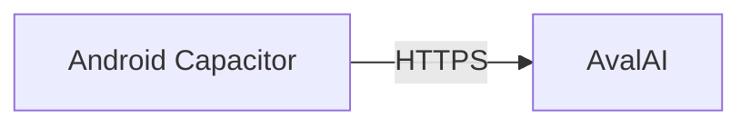

# asrparser Android (standalone)

The phone app is the same UI as [`ui-template`](../ui-template), running **on-device**:

- Admin username/password → phone storage
- AvalAI token + models → phone storage
- Audio + transcripts + evaluations → IndexedDB on the phone
- ASR / LLM → direct HTTPS to AvalAI (no PC FastAPI)



The desktop browser can still use the FastAPI server; the Android build sets `ASR_STANDALONE` and does not need uvicorn.

## What you need

1. Node.js
2. Android SDK / emulator or a USB phone
3. An AvalAI API token (pasted in the app on first launch)

## One-time setup

```bash
cd mobile
npm install
npm run sync-www
npx cap add android   # once
npm run cap:sync
```

## Every UI change

```bash
cd mobile
npm run cap:sync
```

Then rebuild/run from Android Studio, or:

```bash
cd android && ./gradlew assembleDebug
# APK: app/build/outputs/apk/debug/app-debug.apk
```

## First launch

1. Create admin username/password (stored on the phone).
2. Paste AvalAI base URL + token + models (green ✓ = listed on AvalAI).
3. Upload audio — transcription and agent review run against AvalAI from the device.

**Note:** The AvalAI token lives in WebView `localStorage` on the device. That is fine for a personal admin tool; do not ship a shared production key this way.

## Project layout

| Path | Role |
| --- | --- |
| `www/` | Generated copy of `ui-template` (do not edit by hand) |
| `android/` | Native Android project |
| `scripts/sync-www.js` | Copies UI + sets `ASR_STANDALONE` |
| `capacitor.config.json` | App id `ir.embed.asrparser` |
